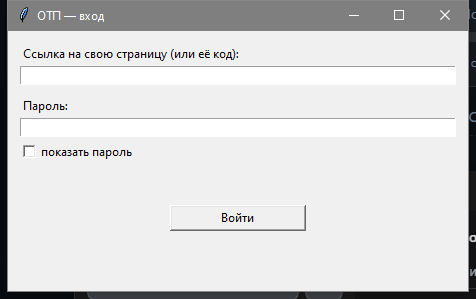
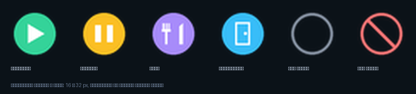

# Установка приложения «ОТП» на Windows

## 1. Где взять инсталлятор

- Ссылка (всегда последняя версия): **https://videoxiter.github.io/9a57a59df2fd/downloads/OTP-Tray-Setup.exe**
- Файл на диске после сборки: `dist/OTP-Tray-Setup-1.4.exe` (в репозитории не хранится, публикуется этим файлом).

Альтернатива без установки: `https://videoxiter.github.io/9a57a59df2fd/downloads/OtpTray.exe` (portable, просто запустить).

## 2. Установка (3 шага)

1. Скачать `OTP-Tray-Setup.exe` и запустить двойным щелчком.
2. Если Windows покажет синее окно **«Система Windows защитила ваш компьютер»** —
   нажать **«Подробнее» → «Выполнить в любом случае»**. Это нормально:
   у инсталлятора нет платной цифровой подписи.
3. Перед установкой отметить галочками:
   - **«Создать значок на рабочем столе»** — по желанию;
   - **«Запускать приложение при входе в Windows»** — рекомендуется.

Программа ставится **в профиль пользователя** (`%LOCALAPPDATA%\OtpTray`), права
администратора не нужны. Ярлык появляется в меню «Пуск» → «ОТП».

В конце установки нажать **«Запустить ОТП сейчас»** — приложение стартует сразу,
и в трее появляется значок.

## 3. Первый вход

1. В поле «Ссылка на свою страницу (или её код)» вставить ссылку, которую прислал
   руководитель (или только код из неё). Если ссылка уже в буфере обмена,
   она подставится сама.
2. Ввести пароль. Сомневаетесь в опечатке — поставьте галочку **«показать пароль»**.
3. Нажать **«Войти»**. Значок появится в трее **только после успешного входа** —
   это нормально: до входа приложение не работает со сменами.

Дальше пароль не спрашивается: он хранится только на этом компьютере.

## 4. Как выглядит значок

- зелёный — работаете;
- жёлтый — перерыв;
- сиреневый — обед;
- голубой — временное отсутствие;
- серый — смена не начата;
- красный — нет связи.

Windows: значок справа внизу, может прятаться под «^».
macOS: значок в строке меню.

## 5. Как пользоваться

Щёлкнуть по значку → меню:

- **Начать смену**, **Техперерыв 1/2**, **Обед**, **Вернуться с перерыва**,
  **Временное отсутствие**, **Завершить смену**.
- Перед действием идёт **отсчёт 10 секунд** с кнопкой «Отмена»;
  повторный щелчок по тому же пункту применяет сразу.
- **Справка** — краткая инструкция внутри приложения.
- **Горячие клавиши…** — настроить свои сочетания.
- **Проверить обновление**, **Проверить новые данные**, **О программе**, **Выход**.

## 6. Автозапуск и обновления

- Автозапуск включается галочкой в инсталляторе (или повторным запуском установщика).
  Отключить: правка реестра `HKCU\Software\Microsoft\Windows\CurrentVersion\Run` →
  удалить `OtpTray`, либо «Параметры → Приложения → ОТП → Удалить».
- Обновления: приложение само проверяет новую версию раз в сутки и ставит её,
  **настройки и статусы при этом сохраняются**. Вручную: меню → «Проверить обновление».

## 7. Удаление

«Параметры» → «Приложения» → «ОТП — учёт рабочего времени» → «Удалить»
(или «Программы и компоненты»). Удаляются программа, ярлыки и автозапуск.
Настройки входа лежат в `%APPDATA%\OtpTray\config.json` — при необходимости
удалить вручную.

## 8. Если что-то не так

| Что видно | Что делать |
| --- | --- |
| «Неверный пароль или ссылка» | Проверить ссылку и пароль; в окне ошибки видно ответ сервера и код страницы — можно показать руководителю |
| «Нет связи с сервером» | Проверить интернет/VPN; приложение повторит запрос само |
| Ошибка про сертификат | Корпоративный прокси подменяет сертификат — приложение повторяет запрос без проверки цепочки, это заложено |
| Значок красный | Нет связи, переподключение автоматическое |
| Нужен журнал | Меню → «Журнал приложения» (файл `app.log` рядом с настройками) |
| Не видно версию | Меню → «О программе» — там версия и автор |

Автор: **Евгений Евгеньевич Яковлев**.
